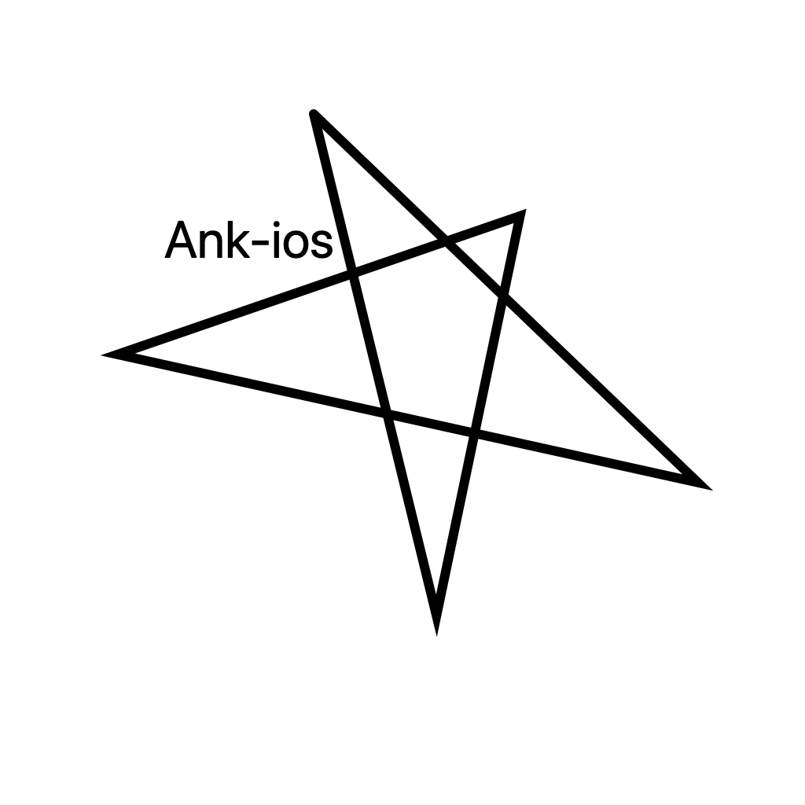
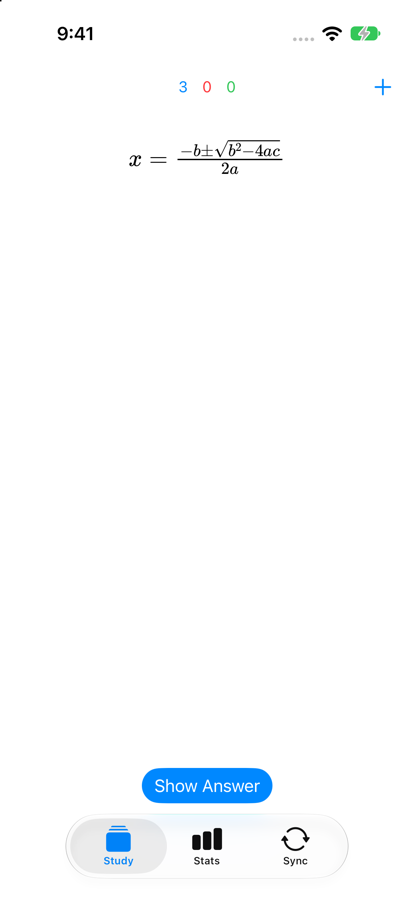
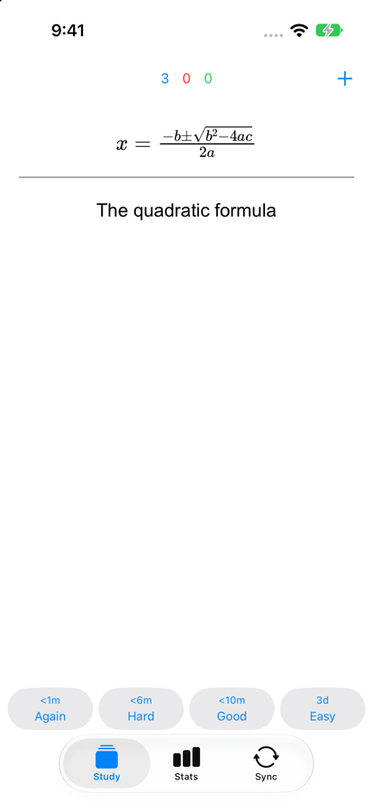
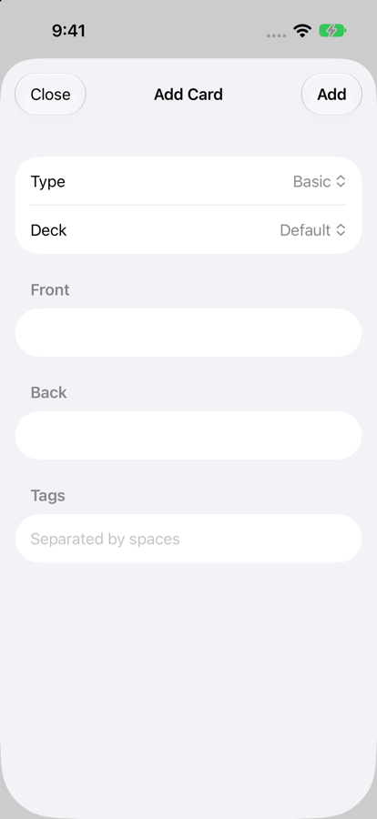
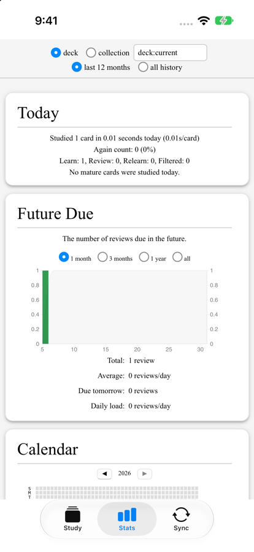
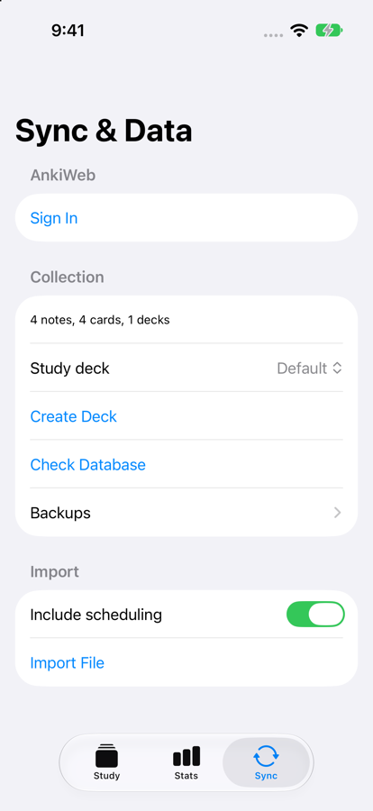

# Ank-ios

An unofficial native iOS flashcard app built on Anki's open-source Rust core and web pages (from
Anki 26.09.4). It syncs with AnkiWeb, works offline, and keeps your scheduling compatible with
other Anki apps.

This project is not affiliated with or endorsed by Ankitects. It is an early, independent project
and is not yet a full Anki client. **Back up your collection before syncing a real account with it**,
because a bug in an early client can spread to AnkiWeb and your other devices.

| Study | Answer | Add Card | Stats | Sync & Data |
|---|---|---|---|---|
|  |  |  |  |  |

## What it can do

- **Study:** Anki's own scheduler (including FSRS) and card rendering, with math, images and undo
- **Listen:** `{{tts}}` cards are spoken with iOS voices, following deck autoplay settings
- **Offline:** study with no connection. Work stays on the device and syncs when a connection returns
- **Sync:** AnkiWeb or a self-hosted server, including media, automatically on opening and leaving
- **Conflicts:** a full upload or download always asks first, and makes a backup before a download
- **Create:** add notes, including cloze notes, with tags and duplicate checks, and create decks and subdecks
- **Custom Study:** all six options, plus unbury
- **Stats:** Anki's graphs
- **Import:** `.apkg`, `.colpkg` (current and legacy), and `.txt`, `.csv` or `.tsv` text files
- **Protect:** restore or share backups, Check Database, and force a full sync

Not implemented yet: a full deck list and overview, the card browser, editing notes, images and
formatting in new notes, `[sound:]` audio and video, type-in-answer, flags and other review tools,
redo, custom scheduling scripts, exporting, and languages other than English. Image Occlusion cards
are untested.

## Device support

The app requires iOS 17 or later. Results below come from this project's own testing.

| Device | Status |
|---|---|
| iPhone 17 Pro, iOS 27 (physical device) | Fully supported |
| iPhone 17 simulator, iOS 27 (Apple Silicon Mac) | Fully supported |
| Other iPhones able to run iOS 17 or later (iPhone XS, XR, SE 2nd generation and newer) | Not tested |
| iPads able to run iOS 17 or later | Not tested |
| iPhone X, iPhone 8 and older, and iPads without iOS 17 | Not supported |
| Simulators on Intel Macs | Not supported |
| Apple Watch, Apple TV, Apple Vision Pro | Not supported |

"Fully supported" covers the features listed above. Syncing has been tested with small collections
(about 240 notes) on AnkiWeb, and with 100,000 notes on a local server.

## Build it

You need an Apple Silicon Mac with Xcode (developed with Xcode 27). The first setup downloads Anki's source and
takes several GB.

    git clone https://github.com/NoisyScope/ank-ios.git
    cd ank-ios
    scripts/setup.sh

Open `AnkiStudy.xcodeproj`, choose a simulator or device, and press Run. On a real iPhone:

- Select your team under Signing & Capabilities, and change the bundle identifier to your own.
- Turn on Developer Mode, and trust your profile under Settings → General → VPN & Device Management.
- With a free Apple account, the app stops opening after 7 days until you run it again.
  Reinstalling over it keeps your data, but deleting the app doesn't.

## How it works

The Swift app shows Anki's real `reviewer.js` in `WKWebView`. A `WKURLSchemeHandler` replaces desktop's
`mediasrv`: it serves the web files and passes protobuf POSTs to the Rust backend. Native code calls the
same backend through generated Swift protobuf types. Debug builds include a test runner, which is
compiled out of Release builds.

## Test it

Debug builds include a test runner, driven by launch arguments. It is compiled out of Release builds.

    DEVELOPMENT_TEAM=YOURTEAMID tests/run_all.sh    # everything, in an iPhone simulator
    DEVELOPMENT_TEAM=YOURTEAMID DEVICE=YOURUDID build/anki/out/pyenv/bin/python tests/device_test.py

`DEVELOPMENT_TEAM` is needed because the sync tests use the Keychain, which requires a signed build.
Set `SIM` to choose a simulator. `device_test.py` runs on a connected, unlocked iPhone, and it
**erases the app's data on that phone**.

| Test | Proves |
|---|---|
| `web_test.py` | Anki's web pages work, and page access rules hold |
| `custom_study_test.py` | Custom Study and Unbury work from the Congratulations page, and card scripts can't open them |
| `deck_test.py` | Creating decks and subdecks, reused names, blank names, and a new deck syncing to desktop |
| `offline_test.py` | Studying with no connection or a dead one, keeping that work, and syncing when it returns |
| `undo_test.py` | Undoing answers and added notes, and that undo stops at what has already synced |
| `sync_safety_test.py` | Automatic sync, staying awake, stopping safely, Check Database, forced full sync, and restoring backups |
| `package_test.py` | Legacy `.colpkg` files, spoken `{{tts}}` cards and their deck settings, and text file import |
| `add_card_test.py` | Adding notes as desktop does: defaults, cards made, checks, sticky fields, and syncing to desktop |
| `kill_test.py` | No recorded answer is lost when the app is killed mid-review, and suspend is safe |
| `sync_test.py` | Round trips with a desktop client: merges, media, conflicts, confirmation prompts |
| `import_test.py` | `.apkg` and `.colpkg` import, corrupt files, and restoring a backup |
| `scale_test.py` | 100,000 notes and 450,000 reviews import, open, sync and stay quick in Release |

The sync tests use Anki's own sync server on this Mac with a throwaway account from
`tests/sync-test.env`. They never contact AnkiWeb.

## Rebuild the libraries

`scripts/setup.sh` builds `lib/` and `web/` and regenerates `Sources/Generated/` from Anki's source. Rust, `just`,
`n2`, `protoc-gen-swift` and Anki's other build tools are fetched into `build/`, so your system is
untouched. `build/` takes several GB. Xcode doesn't need it, but the tests and
`scripts/build-bridge.sh` do. Set `ANKI_TAG` to change the Anki version; the Rust version follows the
tag's `rust-toolchain.toml`. Keep `SWIFT_PROTOBUF` in step with the Xcode project.

After changing `bridge/`, `scripts/build-bridge.sh [debug|release]` is enough.

This project's path must not contain spaces, because Anki's `./ninja` script doesn't quote paths. It builds on Apple Silicon Macs only.

`scripts/gen_methods.py` regenerates the backend method table and the allow-list from Anki's own
source each time, so they follow the version being built.

## Layout

| Path | Contents |
|---|---|
| `Sources/Backend/` | Rust FFI, typed calls, and the collection's open and close lifecycle |
| `Sources/Web/` | URL handler and web views |
| `Sources/Study/` | Study screen |
| `Sources/Sync/` | Sign-in, sync and Keychain storage |
| `Sources/Data/` | Deck selection and creation, adding cards, and import |
| `Sources/SelfTest/` | Test runner, compiled only with `SELFTEST` |
| `Sources/Generated/` | Swift protobuf code from Anki's `proto/` |
| `bridge/ios_bridge/` | Rust C API, compiled inside Anki's workspace |
| `tests/` | Simulator and device tests |
| `docs/screenshots/` | The images in this README |

## Safety rules

Card HTML is untrusted, so these match desktop's rules and should not be loosened:

- Reviewer pages can call only the reviewer whitelist. Other pages get `exposed_backend_list`.
- POSTs need `Content-Type: application/binary`.
- Navigation outside the `anki:` scheme is blocked. `javascript:` links stay on the page, so they are allowed.
- App commands such as `customStudy` are only accepted from the page that owns them, never from cards.

Sync and import follow desktop's data rules:

- A full upload or download always needs confirmation, and has a visible Cancel.
- A backup is made before a full download, an import, or replacing the collection, and can be restored
  or shared from Sync → Backups.
- A sync can run by itself on open and on leaving the app, but a full sync always waits for you.
- Study never waits for the network. Work stays on the device and syncs when a connection returns.
- The sync token is kept in the Keychain, and the password is never stored.
- The collection is closed in the background, because iOS can kill a suspended app.

## License

Ank-ios is licensed under the GNU Affero General Public License, version 3 or later. See
[LICENSE](LICENSE), and [NOTICE](NOTICE) for how it relates to Anki and its other components.

"Anki" is a registered trademark of Ankitects Pty Ltd, used here only to describe compatibility.
